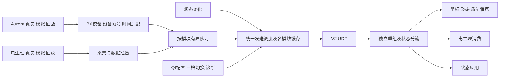

# SimTransfer V2 与 Aurora 完整升级方案评比

日期：2026年11月17日。状态：基于当前工作区的实施方案与选型建议，尚未修改运行代码或执行新版性能测试。

推荐方案B：在现有Qt软件内，将Aurora与电生理采集、数据准备和统一发送进一步分离，同时补齐V2接收消费、诊断及验收。100Mbps、1GbE、2.5GbE切换是所有方案的共同必选功能，1GbE为首选及首次启动默认值，不作为方案之间的取舍。

本文件是整体升级方案。[三档网络配置公共子方案](D:/SimTransferRT/docs/V2_NETWORK_PROFILE_PLAN_2026-11-17.md)作为所有方案共同执行的细则，不替代对协议、Aurora、接收端和系统架构的改造。

## 1 共同交付范围

所有方案均须交付下表内容。A不是删减功能的版本，C和D也不能以后台服务或硬件为由省略SimTransfer界面与报告。

| 共同必选项 | 交付要求 |
|---|---|
| 三档网络切换 | GUI和CLI均支持100Mbps、1GbE、2.5GbE；1GbE默认；保存选择；停止后切换；档位参与实际调度、预检和报告。 |
| V2多帧协议 | NDI、电生理、状态独立；明确与V1分离；不得继续使用旧组合帧和module_mask。 |
| Aurora定义 | 标准BX编解码、长度和CRC16校验、位置/姿态/质量/状态语义、设备帧计数和真实长度；模拟、回放及真实设备使用同一数据模型。 |
| 独立采集和发送 | 两路各自采集与成帧，统一调度状态、首发和补发，不让另一模块的丢帧阻塞当前模块。 |
| 完整接收处理 | 独立重组、NACK、顺序消费、过期处理、状态应用、坐标/波形消费接口与显示验证。 |
| 时间适配 | 保留源采样、主机就绪、发送及接收时间；实现可验证的共同时间域映射，不能把主机收包时刻冒充设备采样时刻。 |
| 验收与诊断 | 分模块六列验收表，跳采、完整首发、逐包间隔、重试时序、收发对账和显示结果；缺证据保留未检测。 |
| 兼容性 | 保留V1明确入口、旧报告读取和当前已完成的Windows UDP、Stop、计时及诊断修复；不覆盖已保留版本。 |

最终软件应具有上述完整能力。真实硬件或业务格式尚未提供的项目可以先用明确的模拟/回放输入验证接口和功能，但不能因此宣称真实硬件验收已完成。

## 2 当前版本与目标版本的差距

当前软件已有Qt界面主线程与独立UDP工作线程，已有有界命令/反馈处理、Stop优先、限频快照、Windows异常处理及诊断导出。方案B并不是首次分离GUI和网络，而是进一步移走真实设备等待、解析和组帧对发送关键路径的干扰。

| 当前行为 | 目标行为 |
|---|---|
| 全模块组装到一个逻辑帧，共享帧号及模拟时间戳 | NDI、电生理各自帧号、采样时间、分片与期限；状态独立序号和单包快照 |
| 统一50Hz、15ms、全局三槽缓存 | NDI约60Hz/15ms、电生理50Hz/18ms，各自四帧缓存；真实NDI频率另需设备确认 |
| 模块体为不透明模拟字节或文件 | NDI具备真实Aurora语义；电生理按设备业务格式接入 |
| 旧NACK区间及全局重组状态 | V2片号列表，所有查找和定时以(module_id, frame_id)隔离 |
| 网络选项仅参与容量估算，不改变PacketPacer | 三档参与统一线路预算、调度、预检、日志和设置保存 |
| Python接收测试桩，没有正式时序显示 | 保留独立参考测试桩，新增实际接收消费和显示路径 |
| 单组合帧报告及旧同步假设 | 按模块统计，独立显示后依据共同时间戳关联 |

因此最小方案也属于中等偏大的改动，不能仅更改帧长、网口选项或几项常量。

## 3 所有方案共用的协议改造

### 3.1 V2线格式与发送

- 按V2固定模块标识及DATA、NACK、STATUS三种类型编解码，明确偏移、小端字节序、长度和CRC32；禁止直接发送本机C++结构体内存。
- 保持UDP应用层最大1472字节、DATA载荷步长1436字节、DF和不使用IP分片。通用单模块数据帧上限仍为2MiB，不能因为当前业务较小而缩改协议上限。
- NDI、电生理各自递增frame_id并保留最近四个完整帧，缓存、待发队列、取消和去重键都包含模块号。状态变化发送完整快照，载荷最多1444字节，无分片、无NACK。
- 同一调度器处理三类流量，优先级为状态、首发、补发。优先级作用于尚未提交的数据报；已进入内核/网卡的包无法由应用层追回，因此发送队列必须有界。
- 保留每模块原始采样计划、首发计划及截止时间。迟到后的重排另记，不允许通过移动计时基准掩盖超期。

### 3.2 接收与消费

- 按模块独立重组、识别重复/迟到/冲突片，任一模块故障不得作废或暂停另一模块。
- 保持同模块2ms尾片检测、首次缺片立即请求、后续10ms间隔、三轮请求及超时作废规则。NACK使用片号列表，跨模块或帧号不得合并。
- 分别设置重组保留期限和显示有效期限。约一帧的显示缓冲不等于只能保留一帧重组状态；旧帧补齐后不得倒序覆盖已显示的新数据。
- 状态独立应用；坐标和电生理各自消费，按共同时间戳做最近邻关联，明确匹配允许的时间差及无新数据时的显示状态。
- 新增实际接收显示路径。NDI可显示工具位置、姿态、质量与有效性；电生理真实波形需要通道、样本位宽、采样率、布局等业务定义，200KB只确定容量。定义缺失时可以验证字节交付和模拟波形，但真实波形验收仍未检测。

### 3.3 必须统一的协议歧义

V2 NACK表中CRC位置与最小长度互相矛盾。建议双端统一为uint16片号列表、CRC偏移20＋2N、总长24＋2N，单片请求26字节；正式实现需形成同一协议决定，不能发送端和接收端分别采用矛盾写法。

“状态立即发送”、状态最大突发、15/18ms计时边界、显示有效期和重启会话规则需要明确。方案不通过放宽阈值或增加未经约定的线上字段绕过这些问题。状态的最后一次快照丢失后如何刷新，也必须另作补充约定；原文没有规定状态重传。

## 4 所有方案共用的 Aurora 适配合同

### 4.1 数据体选择

建议首版以“一次完整标准BX回复”为一个NDI业务数据体，发送端验证后原样封装进V2 DATA，接收端在UDP校验和重组之后按同一Aurora模型解析。此为本项目的数据体约定，需纳入双端说明，不宣称V2原文已经指定BX封装。

这样可保留设备的工具标识、质量、状态和源帧号，减少重新定义坐标报文的兼容风险。将来若改为自定义归一化记录，必须明确版本、字段、单位及长度，不能偷偷替换数据体。TX文本可作为诊断导入/回放适配，正式数据路径优先统一为BX语义。

### 4.2 字段、长度和有效性

| 项目 | 适配要求 |
|---|---|
| 有效记录 | 42字节：句柄1、有效性1、四元数16、位置12、质量指标4、端口状态4、设备帧号4。 |
| Missing记录 | 10字节：句柄及有效性2、端口状态4、设备帧号4；没有有效位置和四元数。 |
| Disabled记录 | 2字节：句柄及有效性；不能再读取42字节记录体。 |
| 完整回复 | 11＋42V＋10M＋2D字节，V/M/D分别为三类记录数量；包括Aurora自身头与校验，不包括外层UDP封装。 |
| 数值 | 按Rev.9小端IEEE 32位浮点解析；位置单位毫米，四元数无量纲，质量指标不是概率或统一精度百分比。 |
| 5DOF与6DOF | 都按规定字段解析；5DOF质量指标为零不表示完美精度。传感器数、物理端口数和工具句柄数不等同。 |
| CRC | 分别验证Aurora头/体CRC16和外层UDP CRC32，分开计错，不能用一层替代另一层。 |
| 状态 | 保留缺失、禁用、出界、传感器故障等语义；不得将零坐标或上一有效坐标冒充本次新有效坐标。 |
| 越界与预留字段 | BX默认使用0001；不得为持续得到坐标而自动启用0801越界返回。Aurora预留字段按厂商规则忽略其值，不套用UDP V2预留位必须为零的规则。 |
| 回复异常 | 处理部分读取、粘连、长度错误、CRC错误、ASCII ERROR/RESET等输入，保持解析状态有界。 |

BX为变长二进制回复，不能以遇到CR字节就截断。按照头部长度和CRC组织接收、校验和重新同步；内部二进制数据可能含有CR。设备命令按一问一答处理，完整读完一次回复才发送下一条命令，不用并发BX请求追求虚假的采样率。

建议NDI标准BX接收缓冲保护上限16KiB，实际按真实长度发送，不填满缓冲。数量字段保守边界对应10721字节，但不能据此宣称硬件支持255个工具；1691字节只是40条有效记录的计算实例。手册不同章节的句柄范围存在不一致，实际容量需查询设备型号和已启用句柄。VSIU原始数据与跨多时刻聚合不在此长度模型内。

### 4.3 源帧号与UDP帧号

保留每工具的设备Frame Number。常规模式中的＋8是设备计数规则，不是UDP丢了7帧。外层V2 frame_id在本模块内按实际生成的数据帧递增，两者分开记录和判断回绕、重复与重置。

重复读取同一源采样不计为新的硬件采样；不能用60次查询或重复发送旧坐标完成“60Hz新采样”验收。若同一回复中的工具源计数不一致，需要明确业务帧时间定义并记录各工具数据年龄，不能默认整包所有工具来自同一采样时刻。源数据缺口、解析拒绝、UDP丢失和接收超时分开计数。

工具集合、有效性和故障状态的变化仍需独立处理，不能因源帧计数没有增加而一并忽略。外层单一NDI时间戳的含义须与逐工具源计数统一；不得将一个外层时间戳复制给全部工具来伪造同步。

### 4.4 设备生命周期与时间

增加Aurora数据源适配器，处理能力/固件/API查询、句柄枚举、初始化、启用、Tracking、停止和重连。工具连接变化可能需要TSTOP、重新枚举初始化和TSTART，期间只影响NDI链路，电生理和状态继续。设备配置和控制不能在逐包关键路径中阻塞。

标准BX/TX提供设备帧计数，没有直接提供共同时间域的64位微秒采样时间戳。需要读取真实跟踪频率和计数增量率，展开回绕，结合可验证同步基准转换时间，并保留映射误差。主机读完串口的时间只代表主机就绪时刻，不能替代源采样时刻。

手册给出常规40Hz和66Hz快速模式；快速模式精度不确定度增加到2倍，实际还可能受通信速率限制。任何方案都不能自动启用快速模式、把40Hz改名成60Hz或将66Hz直接视为满足未量化的“约60Hz”。真实设备模式与V2目标的兼容性是独立验收条件，未解决时该项不能通过。

## 5 所有方案必须提供的三档切换

| 必选档位 | 公共实现要求 |
|---|---|
| 100Mbps | 可在界面和CLI选择；按百兆预算调度和预检；余量不足时明确提示，超期照常失败。 |
| 1GbE | 首选和首次默认；后续恢复上次有效选择；是当前业务量下的主要实网验证配置。 |
| 2.5GbE | 同样完整支持；作为高速链路和扩展配置，不能要求用户必须购买2.5G硬件才能使用另外两档。 |

三档共用同一协议、算法和阈值，仅改变线路容量预算与由此推导的发送安排。所选档位、本机观测连接速率、已知路径限制和有效预算分别显示；选择档位不修改Windows网卡协商设置，也不证明整条链路同速。

首次默认1GbE，记忆上次选择，GUI及Qt/native CLI一致。沿用现有生命周期，在完全停止后换档、下一轮开始生效，保留快速Stop及未发/取消计数。仅换档时续用模块序号和时间域；设备/接收端重启或序号复位时协调双端状态并隔离旧端点报文。新本地run_id用于报告分组，不冒充线上会话标识。

三档的容量、配置兼容、停止切换和具体测试细则见公共子方案。其内容在A、B、C、D中均为必选。

## 6 性能预算与当前证据

容量示例采用电生理200KiB＝204800字节、50Hz；NDI为40条有效BX记录1691字节、仍按UDP目标60Hz做预算。实际电生理若为200000字节按真实长度，NDI实际工具数未知。以下不含状态、补发、上游接口及主机处理，全部是理论值。

| 指标 | 100Mbps | 1GbE | 2.5GbE |
|---|---:|---:|---:|
| 两路首发平均线路占用 | 88.664% | 8.8664% | 3.5466% |
| 电生理单帧最短出线时间 | 17.551ms | 1.755ms | 0.702ms |
| 同步产生两帧的最短出线时间 | 17.702ms | 1.770ms | 0.708ms |
| 同步窗口距18ms的纯线路余量 | 0.298ms | 16.230ms | 17.292ms |

以上物理预算对四种架构完全相同。100Mbps必须保留为可选项，但“可以选择”不等于该链路能保证任意负载达标。更大NDI回复、状态突发和主机停顿都可能吃完百兆余量。1GbE具备当前负载所需的合理余量；2.5GbE为扩展选择。

不将三档统一限速到80%：在百兆上按80Mbps发送200KiB电生理，单帧出线约21.939ms，已经违反18ms。全局预算按实际包长及所声明负载核算；补发只使用不影响首发期限的余量。

15/18ms需要明确从源采样完成还是主机就绪起算，以及以本地send返回还是实际出线结束。必须分段保留这些时刻，不能为了可行更换起点。条件例子：1691字节经921600波特8N1串行回复，仅串行化约18.35ms；若从源采样完成起算，后续网口再快也无法补偿该段已经消耗的时间。这不是未知设备的实测结论，而是必须单独验证上游接口的理由。

当前11月17日64KiB、50Hz、600秒Windows环回记录中，首发最大1.730ms、分片间隔偏差最大0.613ms，但采样间隔偏差最大105.959ms，并跳过14个计划时隙。这是当前V1的限制证据，不是V2性能预测。A/B/C仍运行在普通Windows上，不能预先保证消除系统级长停顿；D也需证明设备接口和实时平台的实际时限。

## 7 四种完整修改方案

### 方案A 现有进程内渐进改造

保留现有Qt界面与发送工作线程框架。在工作线程中增加NDI、电生理独立状态机，以非阻塞I/O、分步解析和有界准备执行设备工作，统一调度V2发送；接收与显示实现同样完整的独立消费功能。

- 性能：线程交接较少，适合设备调用和单次解析耗时可控的环境；设备I/O、解析与发送仍共享关键执行时间，较容易互相影响。
- 硬件及网络：普通Windows主机即可，三档均具备、1GbE优先。实际SDK/串口必须支持非阻塞、分步或可靠有界调用；不可拆分的长阻塞SDK会使本方案失去适用条件。
- 改动范围：中到大。完整V2、Aurora模型、接收显示和三档都要实现，主要节省并发架构重构；不能用测试桩替代正式接收消费。
- 影响：对现有组织结构较温和，但今后增加设备、解码和诊断功能时需要持续维护每一步耗时边界；长期稳定性的结构余量较小。
- 适用：先验证完整协议互通、设备接口简单且处理时间已验证可控的项目。

### 方案B 进程内分离采集准备与统一发送 推荐

保留现有Qt产品形态。Aurora和电生理使用独立采集/准备入口，产出带来源信息和时间的不可变帧，经有界队列交给统一发送核心。接收重组、独立消费和界面显示各有明确职责；文件读取、设备等待及较重解析不占用逐包发送路径。

- 性能：重点减少设备等待、解析和组帧对发送节奏的影响。三档共用全局预算与期限调度，迟到时不整帧突发，补发不侵占首发。不能承诺普通Windows的最坏抖动必然低于某个值。
- 硬件及网络：现有多核PC可作为开发和验证平台，无须为当前约89Mbps首发业务量默认购买实时硬件或2.5G网络。推荐端到端1GbE，三档完整支持；真实设备接口和同步条件仍要落实。
- 改动范围：大。增加数据源抽象、BX codec、时间映射、队列所有权和取消规则，重构V2核心并新增接收消费。保留Qt界面、UDP传输抽象、诊断框架与大部分部署方式。
- 影响：需验证线程交接、缓存生命周期、队列满、设备重连与快速Stop；但可避免引入额外服务安装、跨进程协议和硬件固件体系。
- 适用：当前原型向长期运行工程软件升级，兼顾真实设备接入、后续扩展和可维护性。

### 方案C 采集发送后台服务与Qt前端分离

将方案B中的设备采集、准备和发送核心运行在独立后台进程，Qt前端通过本地通信配置三档、控制运行并展示诊断。服务持有权威运行配置，前端连接状态不改变正在执行的配置。

- 性能：主要改善界面崩溃、重启和升级的影响范围，不天然比B低延迟；新增进程通信、配置一致性和数据传递开销。同一Windows主机的系统级停顿仍可能影响服务。
- 硬件及网络：普通Windows主机即可，三档均具备、1GbE优先；需要设备驱动可被后台服务访问，以及服务安装、权限和升级条件。
- 改动范围：更大。除B的功能外，增加本地通信协议、版本协商、进程监护、断连恢复、服务部署和日志归并。
- 影响：必须明确前端关闭后继续还是停止、谁可控制设备、如何升级服务；这些属于新增运行和运维复杂度。
- 适用：设备必须长期后台运行、界面可以独立重启，或者确有多客户端管理需求的场景。

### 方案D 将有期限要求的采集发送下沉到实时平台

将关键采集、时间映射和发送节拍移到具有对应驱动的实时控制器、RTOS或适用硬件，Windows继续提供同一SimTransfer界面、三档选择、接收显示与报告。硬件端接收配置并反馈实际采用的档位，不能只在界面上改变标签。

- 性能：具备进一步约束关键任务最坏执行时间的条件；必须对驱动、内存、任务调度、网络和设备响应逐项验证，不能将“采用RTOS/FPGA”等同已经达标。
- 硬件及网络：新增实时平台、设备接口或驱动、共同时间基准及调试条件。实际发送平台需具有100M、1G、2.5G相应链路或正确限速能力；没有对应物理网络的档位只能做仿真预算验证，不能标实网通过。
- 改动范围：最大。新增实时软件/固件、主机控制接口、时钟同步、硬件部署和版本兼容，保留原Qt界面但重新划分核心职责。
- 影响：开发、调试、维护和硬件验证成本最高；Aurora仍受自身40/66Hz模式和串口/USB能力限制，硬件下沉不能改变设备本身的采样定义。
- 适用：明确要求在约定负载下证明严格最坏时限，且有证据说明普通PC路线无法满足的阶段。

## 8 横向评比

以下是基于现有结构的工程判断，不是未经实现的性能测试结果。

| 维度 | A 渐进改造 | B 采集准备分离 | C 独立服务 | D 实时平台 |
|---|---|---|---|---|
| V2完整功能与Aurora语义 | 必须完整 | 必须完整 | 必须完整 | 必须完整 |
| 100M/1G/2.5G切换 | 全部必选，1G默认 | 全部必选，1G默认 | 全部必选，1G默认 | 全部必选，1G默认 |
| 减少采集对发送的干扰 | 依赖非阻塞和有界步骤 | 较好，职责和队列分离 | 同B，另有进程通信成本 | 取决于实时平台和驱动设计 |
| 隔离界面崩溃或重启 | 无进程隔离 | 无进程隔离 | 较好，需明确服务生命周期 | 关键发送独立于Windows |
| 严格最坏延迟保证 | 不能预先承诺 | 不能预先承诺 | 不能预先承诺 | 有条件建立证明，仍需验证 |
| 复用现有软件 | 最多 | 较多 | 中等 | 主机界面及部分逻辑可复用 |
| 新增硬件需求 | 通常无需专用硬件 | 通常无需专用硬件 | 通常无需专用硬件 | 明显增加 |
| 实施复杂度 | 中到大 | 大 | 更大 | 最大 |
| 新增部署影响 | 小 | 较小 | 增加服务与本地通信 | 增加硬件及固件体系 |
| 对当前项目的建议 | 条件适合时可选 | 首选 | 有后台独立运行需求时选 | 严格实时阶段再评估 |

推荐B的理由：当前真实业务量下，1GbE容量有余量，重点是设备接入正确性、关键路径干扰和长期时序证据。B能直接处理这些问题，同时保留现有Qt产品和已有修复；C主要解决生命周期隔离，D的投入则需要更明确的最坏时限需求支撑。

## 9 文件与模块修改范围

| 区域 | 四方案共同修改 | B额外结构重点 |
|---|---|---|
| [协议类型](D:/SimTransferRT/src/protocol/ProtocolTypes.h)与[编解码](D:/SimTransferRT/src/protocol/PacketCodec.cpp) | V1/V2明确分离，DATA/STATUS/NACK、边界及CRC | 核心保持与Qt和设备SDK解耦 |
| [运行配置](D:/SimTransferRT/src/core/Types.h)与[组帧](D:/SimTransferRT/src/core/LogicalFrameBuilder.cpp) | 独立模块配置、三档、源信息；移除V2组合帧假设 | 不可变模块帧和有界所有权交接 |
| 拟新增AuroraCodec、AuroraSource、时间映射模块 | BX格式、CRC16、错误回复、设备生命周期和源帧语义 | 设备I/O与准备独立于发送线程；模拟/回放复用codec |
| [发送核心](D:/SimTransferRT/src/core/RealtimeStream.cpp)、[调度](D:/SimTransferRT/src/core/PacketPacer.h)、[缓存](D:/SimTransferRT/src/core/FrameCache.h) | 模块期限、各四帧缓存、全局预算、状态优先、重传隔离 | 单一发送所有者，不因两路生产者而建立两个争抢socket的独立发送器 |
| [会话](D:/SimTransferRT/src/application/SessionManager.cpp)与[运行循环](D:/SimTransferRT/src/application/StreamRunner.cpp) | 停启、配置快照、分模块统计及取消 | 明确各线程停止顺序、队列满和设备错误传播 |
| [配置界面](D:/SimTransferRT/src/ui/ConfigPanel.cpp)与[CLI](D:/SimTransferRT/src/support/CliOptions.cpp) | 三档、V2模块、NDI来源和状态、旧配置兼容 | 保持统一产品入口与配置真值 |
| 拟新增接收消费/显示模块；[参考接收模型](D:/SimTransferRT/tools/receiver_model.py) | 独立重组、状态、消费、关联、真实NDI显示和电生理接口 | 参考Python实现继续独立校验，正式消费路径与UI更新解耦 |
| [验收导出](D:/SimTransferRT/src/application/AcceptanceReport.cpp)与[联合验收](D:/SimTransferRT/tools/acceptance_report.py) | 六列、分模块、三档、源/网络/显示分层证据 | 开销有界，不把报告构建放进逐包关键路径 |

C在上述基础上新增进程通信和服务部署模块，D新增实时平台及固件工程。A则将更多工作保留在现有工作线程的可中断状态机中；它不减少协议、NDI和接收功能清单。

## 10 实施阶段及验收

1. 固化双端线格式、BX业务体约定、时序测量边界及状态数据结构，保留原版快照和当前工作区修复。
2. 完成V2及Aurora独立codec、模拟/回放数据源和参考接收，先做字节级互通及边界验证。
3. 按选定架构接入真实数据源抽象、模块缓存、统一发送及三档配置。推荐B在此阶段完成采集/准备与发送分离。
4. 补齐接收消费、NDI坐标/质量/缺失显示、电生理业务接口及状态应用，验证时间关联和过期策略。
5. 完成Qt GUI、Qt CLI、native CLI及Python工具回归；旧V1配置与报告保持兼容。
6. 三档分别进行协议、故障、CPU/内存压力和实网性能验证，先单端口再多端口。建议每档600秒联调，1GbE首选档至少2小时长测；物理网络不可用的档位保留未检测，不用环回或软件限速替代实网结论。

| 测试层 | 关键覆盖 |
|---|---|
| Aurora字节与语义 | Valid/Missing/Disabled混合、CRC16、错误长度、分段读取、ASCII错误/RESET、5DOF/6DOF指标、源帧重复/＋8/回绕、工具重连。 |
| V2边界 | 1/1436/1437/2MiB数据体；状态最大1444字节；NACK拆包、非法模块/保留位/片号/CRC；不同模块同帧号。 |
| 调度与隔离 | NDI和电生理同相/错相、状态突发、连续丢片和补发、2ms尾片规则、队列满和Stop、三档切换及原始计划保留。 |
| 性能 | 首发最大值、超期次数、采样缺口、实际源新帧率、逐包间隔、接收校验完成、最终消费及显示、CPU/内存/队列高水位。 |
| 兼容 | V1/V2显式选择、旧CLI、旧报告、GUI设置恢复、设备/接收重启和迟到旧包。 |

所有方案使用同一套验收要求。NDI≤15ms、电生理≤18ms，原有严格小于1ms的采样/分片间隔偏差保留为附加工程目标，不随网络档位放宽。状态“立即”的数值边界未明确、共同硬件时间映射未验证、实际出线未测或真实波形格式未知时，对应项目不能标通过。

最终对比报告使用“要求、测量口径、阈值、实测值、通过/失败/未检测及原因”，分别列源采集、主机准备、发送、网络、接收、消费和显示。收齐不能抵消跳采或首发超期，条件不同的测试不能混作优化前后因果对比。

## 11 参考依据与本轮边界

- [新版UDP协议](C:/Users/32966/OneDrive/文档/xwechat_files/wxid_yk33pp9h3wgs12_4022/msg/file/2026-11/UDP协议——多帧版本.docx)。
- [Aurora API Guide Rev.9](<C:/Users/32966/OneDrive/文档/xwechat_files/wxid_yk33pp9h3wgs12_4022/msg/file/2026-11/NDI/DDUG-010-466-09- Aurora Application Program Interface Guide, Rev. 9 .pdf>)：印刷第3—6页通信与帧计数、第17—19页设备/时间参数、第24—27页BX、第29—30页串口、第50—51页句柄生命周期、第78页快速模式、第83—85页TX、第104—105页CRC16。
- [当前11月17日修复与测试](D:/SimTransferRT/docs/TIMING_FIX_2026-11-17.md)。
- [NDI及电生理容量计算](D:/SimTransferRT/artifacts/udp-stability/v2-assessment-20261117/aurora-ep-capacity-revision.json)。

本轮输出完整修改方案及比较，不修改运行代码、不更改协议阈值、不启用真实设备快速模式、不提交或推送仓库。当前推荐方案B；三档切换在任何最终选用方案中都必须保留。
